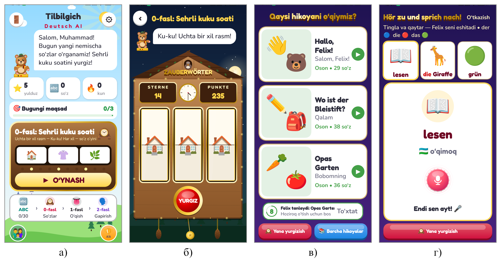
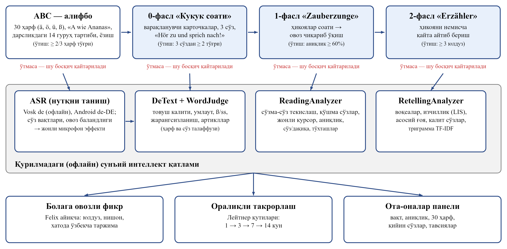

# 🇩🇪 Tilbilgich De AI

**Nemis tili · 1–2-sinf · Android · o‘zbek tilida**

Nemis tilini Felix ayiqcha bilan o‘rganing: rangli artikllar, kukuk soati va talaffuzni tinglaydigan sun'iy intellekt.

## Ilova haqida

«Tilbilgich De AI» — boshlang‘ich sinf o‘quvchilariga nemis tilini o‘yin orqali o‘rgatuvchi ilova. Ko‘rsatmalar o‘zbek tilida, tirol shlyapasidagi «Felix» ayiqcha ovozi bilan beriladi. Kontent «Deutsch mit Spaß» 1- va 2-sinf darsliklari asosida: 30 harf (Ä, Ö, Ü, ß bilan), artikli bilan 217 so‘z va 48 hikoya hamda ertak. Otlar rangli artikllar bilan o‘rgatiladi: der — ko‘k, die — qizil, das — yashil.

## Imkoniyatlar

- «Deutsch mit Spaß» darsliklari asosida: 30 harf, 217 so‘z, 48 hikoya va ertak
- Rangli artikllar: der — ko‘k, die — qizil, das — yashil
- «Tovush kaliti»: umlautlar, ß, so‘z oxiridagi jarangsizlanish, qo‘shma so‘zlar
- «Sehrli kukuk soati» — Shvarsvald soati va vokzal tablosidek kartochkalar
- «Hör zu und sprich nach!» talaffuz mashqi, internetsiz baholash
- Bosqichma-bosqich o‘tish, oraliqli takrorlash, ota-onalar paneli

## O‘yin ssenariysi

1. Alifbo — Felix harfni aytadi, bola qaytaradi
2. 0-fasl «Sehrli kukuk soati» — so‘zlar artikli bilan
3. 1-fasl — hikoyalar soati: tinglash va ovoz chiqarib o‘qish
4. 2-fasl — hikoyani nemischa qayta aytib berish

## 🏆 Natija

Beshta analog bilan ekspert taqqoslashida **35 balldan 31 ball**.

## O‘rnatish

1. **[tilbilgich-de.apk](https://github.com/MSoqiy/tilbilgich-de/raw/main/apk/tilbilgich-de.apk)** faylini yuklab oling (APK papkasi — [apk/](https://github.com/MSoqiy/tilbilgich-de/tree/main/apk)).
2. Faylni oching; telefon so‘rasa, «Noma'lum manbalardan o‘rnatish»ga ruxsat bering.
3. «O‘rnatish»ni bosing.

## Ekranlar

## English

**Tilbilgich De AI** — German for Uzbek-speaking kids with colour-coded articles and offline pronunciation scoring. Free, ad-free. Part of the «Ta'limiy o‘yinlar» collection by Mamasaidov M.A..

---

**Muallif:** Mamasaidov M.A. — Toshkent shahar Mirzo Ulug‘bek markazi o‘qituvchisi · Tetrasoft · ✉ soqiy65@gmail.com · 🌐 https://msoqiy.github.io · «[Ta'limiy o‘yinlar](https://msoqiy.github.io/oyinlar/)»

**Boshqa ilovalar:** [Otin buvi](https://github.com/MSoqiy/otin-buvi) · [Donish bobo](https://github.com/MSoqiy/donish-bobo) · [Bayon AI](https://github.com/MSoqiy/bayon-ai) · [Tilbilgich En AI](https://github.com/MSoqiy/tilbilgich-en) · [Tilbilgich Fr AI](https://github.com/MSoqiy/tilbilgich-fr) · [Tilbilgich Ar AI](https://github.com/MSoqiy/tilbilgich-ar) · [Aljabr](https://github.com/MSoqiy/aljabr) · [GeoSayyoh](https://github.com/MSoqiy/geosayyoh) · [So‘zla](https://github.com/MSoqiy/sozla)

Kalit so‘zlar: nemis tili bolalar uchun, nemis tilini o‘rganish, Deutsch für Kinder, nemischa so‘zlar, der die das, Deutsch mit Spaß, немецкий для детей на узбекском языке, o‘zbekcha ta'limiy o‘yin, android apk
